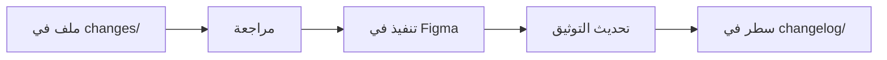

# طلبات التعديل (Changes)

أي إضافة أو تعديل مطلوب في التصميم يبدأ هنا كملف، قبل تنفيذه في Figma.

## الدورة

1. انسخ [shared/templates/change-request-template.md](../../shared/templates/change-request-template.md) باسم `YYYY-MM-DD-short-title.md`.
2. اكتب المطلوب والشاشات والمكوّنات المتأثرة.
3. بعد التنفيذ: غيّر الحالة إلى `منفّذ`، وحدّث ملفات التوثيق المتأثرة، وأضف سطراً في [changelog/](../changelog/).

## الطلبات المفتوحة

| الملف | العنوان | الحالة |
|---|---|---|
| [2026-11-16-enaya-visits.md](2026-11-16-enaya-visits.md) | نقل بيزنس الزيارات من Enaya | مفتوح |
