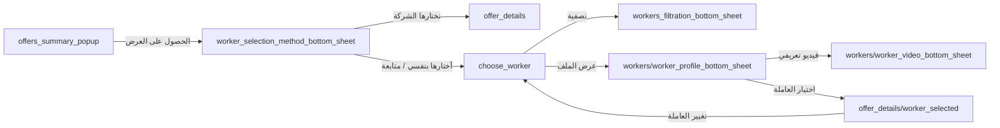

# 0008: رحلة اختيار العاملة في خدمات الأفراد

| البند | القيمة |
|---|---|
| الحالة | معتمد |
| التاريخ | 2026-11-23 |
| صاحب القرار | العميل (عن طريق Menna Elsayed) |

## السياق
بعد [قرار 0007](0007-worker-selection-from-offer-company.md) (العاملات من الشركة صاحبة العرض بس)، كان لسه محتاجين نحدد 3 حاجات: الخطوة تيجي فين في رحلة `monthly_offers`، هل العميل يقدر يسيب الاختيار للشركة، وإيه اللي يبقى في الفلتر.

## الخيارات
- **المكان:** بعد ملخص العرض (زي معين)، أو قسم جوه تفاصيل التعاقد.
- **من الشركة:** الاختيارين («أختارها بنفسي / تختارها الشركة»)، أو العميل يختار دايماً.
- **الفلتر:** النوع، الخبرة، الديانة، المهارات (أي مجموعة منهم).

## القرار
- **المكان:** بعد ملخص العرض. «الحصول على العرض» بيفتح سؤال طريقة الاختيار.
- **من الشركة:** الاختيارين.
  - «تختارها الشركة» بتودّي لتفاصيل التعاقد الحالية (`monthly_offers/offer_details`)، وفيها الملاحظة «سيتم اختيار العاملة من فرع الشركة».
  - «أختارها بنفسي» بتودّي لقائمة العاملات.
- **الفلتر:** الأربعة: النوع (أنثى / ذكر)، الخبرة (خبرة / بدون خبرة)، الديانة (مسلمة / غير مسلمة)، المهارات (مهام المنزل اليومية، الغسيل، كي الملابس، مربية أطفال، حاصلة على شهادة تدريب).

## الأثر
- **Figma:** 4 فريمات جديدة في `monthly_offers/*`، والملف الشخصي بيستخدم `workers/worker_profile_bottom_sheet` (التفاصيل في [workers.md](../product/features/workers.md#الشاشات))، و«الحصول على العرض» في `monthly_offers/offers_summary_popup` بقى بيفتح سؤال طريقة الاختيار بدل ما يروح لتفاصيل التعاقد على طول.
- **ملفات التوثيق:** `workers.md`، `monthly-and-medical.md`، `status.md`، الـ audit، `screens.json`، `screens-index.md`، والـ changelog.
