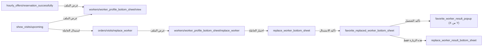

# 0012: العاملات في خدمات الساعة (التعيين، الظهور، الاستبدال)

| البند | القيمة |
|---|---|
| الحالة | معتمد |
| التاريخ | 2026-11-24 |
| صاحب القرار | العميل (عن طريق Menna Elsayed) |

## السياق
في معين، النظام بيعيّن عاملة على كل زيارة ساعة، والعميل بيشوفها قبل الدفع، وبيقدر يستبدلها بعدين ([المرجع](../product/references/mueen-workers.md#مسار-الساعة)). في بالخدمة، العاملة كانت بتظهر كاسم بس في الزيارات بعد الحجز.

## القرار
| السؤال | القرار |
|---|---|
| العميل يختار العاملة قبل الحجز؟ | **لأ.** الشركة صاحبة العرض بتعيّن عاملة لكل زيارة حسب الإتاحة |
| العاملة تظهر إمتى؟ | **قبل الدفع، زي معين.** في تفاصيل الطلب، بعد اختيار الأيام وتاريخ البدء: العاملة على كل زيارة + «عرض الملف» |
| «عدد العاملات» (1 لـ 5) على العروض؟ | **لأ دلوقتي.** عدد العاملات جزء من العرض نفسه. ⚠️ ده **مختلف عن معين** (معين فيه فلتر لعدد العاملات والسعر بيتضرب فيه)، وأي اختلاف عن معين محتاج قرار مشترك مع م. سند ([الذاكرة](../memory/MEMORY.md#قواعد-البيزنس)) **(يحتاج قرار مشترك)** |
| الاستبدال؟ | **أيوه.** من الزيارات القادمة، وقبل الدفع من تفاصيل الطلب ([قرار 0019](0019-replace-worker-before-payment.md))، والعاملات من الشركة نفسها ([قرار 0007](0007-worker-selection-from-offer-company.md)، وهو ⚠️ **محل مراجعة**، فلو اتغير هتتغير قائمة الاستبدال معاه). بعد الاستبدال بنسأل «هل تريد تفضيل العاملة؟» لباقي الزيارات، لأن التثبيت = التفضيل ([قرار 0004](0004-favorite-is-pinning.md)) |

## الأثر
- **Figma:** `visit_details` (زرار «عرض الملف» جنب اسم العاملة في الكروت المفتوحة، و«استبدال العاملة» جنب «تأجيل الزيارة» في القادمة)، و7 فريمات جديدة. التفاصيل في [workers.md](../product/features/workers.md).
- **ملفات التوثيق:** `workers.md`، `visits.md`، `hourly-services.md`، `organisms.md`، `glossary.md`، `status.md`، `deviations.md`، الـ audit، `screens.json`، `screens-index.md`، والـ changelog.
