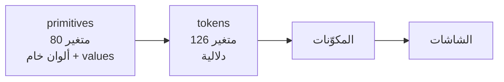

# نظام التصميم: نظرة عامة

## المبادئ
1. **Atomic Design:** Atoms ← Molecules ← Organisms ← Templates ← Screens. كل مستوى يُبنى من المستوى اللي قبله.
2. **التوكنز أولاً:** لا توجد قيمة لون أو مسافة أو زاوية مكتوبة يدوياً. كل القيم مربوطة بمتغيرات.
3. **RTL:** كل المكوّنات مصممة للعربية من اليمين لليسار.
4. **الشاشة = instances:** الشاشات في `screens` لا تحتوي على عناصر مرسومة يدوياً إلا للضرورة.

## هيكل المتغيرات

| Collection | العدد | المحتوى |
|---|---|---|
| `primitives` | 80 | 6 مجموعات ألوان × 11 درجة، و`values/*` (المقاييس الرقمية)، و`deep_slate`، و`gray`، و`effects/*` |
| `tokens` | 126 | `backgrounds/*`، `buttons/*`، `text/*`، `borders/*`، `badges/*`، `notifications/*`، `radius/*`، `padding/*`، `spacing/*`، `font/*`، `shadows/*` |

**القاعدة:** المكوّنات تستخدم `tokens` فقط. الـ `primitives` لتعريف الـ tokens.

كل collection فيها mode واحد (`Mode 1`)، ولا يوجد وضع داكن (dark mode) حالياً.

## الأساسيات (Foundations)

| الملف | المحتوى |
|---|---|
| [foundations/colors.md](foundations/colors.md) | الألوان الخام والدلالية |
| [foundations/typography.md](foundations/typography.md) | الخطوط والـ text styles |
| [foundations/spacing-and-radius.md](foundations/spacing-and-radius.md) | المسافات والحواف والزوايا والتخطيط |
| [foundations/effects.md](foundations/effects.md) | الظلال والأسلوب البصري |

## المكوّنات (Mobile)

| الملف | العدد |
|---|---|
| [mobile/atoms.md](mobile/atoms.md) | 26 مجموعة |
| [mobile/molecules.md](mobile/molecules.md) | 36 مجموعة |
| [mobile/organisms.md](mobile/organisms.md) | 40 مجموعة |
| [mobile/templates.md](mobile/templates.md) | 5 templates |
| [mobile/screens-index.md](mobile/screens-index.md) | 95 إطاراً |

## باقي الأقسام
- [icons-and-images/](icons-and-images/): الأيقونات والصور والرسومات.
- [web/](web/): لا يوجد تصميم ويب حالياً.
- [audits/](audits/): مراجعات جودة الملف.
- الانحرافات المعروفة عن النظام: [../brand/deviations.md](../brand/deviations.md).

## اصطلاحات التسمية

| العنصر | الصيغة | مثال |
|---|---|---|
| مجموعة مكوّن | `snake_case` | `service_order_card` |
| خصائص الـ variants | `state=`، `type=`، `status=`، `size=` | `state=hourly, status=active` |
| قيم الـ variants | `snake_case` وصفية | `nearing_expiration` |
| شاشة | `section/sub_section/state` | `mediation/well_known_maid/maid_data` |
| Bottom sheet | ينتهي بـ `_bottom_sheet` أو `_popup` | `orders/order_details/invoice_bottom_sheet` |
| متغير | `group/name` | `backgrounds/bg_screen` |
