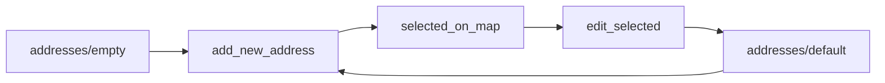

# الحساب: المزيد، الملف الشخصي، العناوين، الشركات، الإشعارات

## المزيد (`more`)
القائمة الجانبية (`side_menu_items`، `state=default|critical`). البند `critical` للإجراءات الحساسة زي تسجيل الخروج أو حذف الحساب **(يحتاج تأكيد)**.

## الملف الشخصي

| الشاشة | الوصف |
|---|---|
| `profile/dashboard` | لوحة الحساب: `profile_header`، و`profile_card` بإحصائيات (`dashboard_statistics`) |
| `profile/edit_profile` | تعديل البيانات والصورة (`profile_avatar_photo`، `state=photo|letter`) |
| `profile/complete_profile` | إكمال البيانات الناقصة |

## العناوين

| الشاشة | الوصف |
|---|---|
| `addresses/default` | قائمة العناوين (`address_item`) |
| `addresses/empty` | لا توجد عناوين (`empty_state`) |
| `addresses/add_new_address` | الخريطة لتحديد الموقع |
| `addresses/add_new_address/selected_on_map` | بعد تحديد الموقع على الخريطة |
| `addresses/add_new_address/edit_selected` | bottom sheet لتعديل تفاصيل العنوان |

العنوان المختار يظهر في الرئيسية (`address_at_navbar`)، ويُستخدم في تأكيد العنوان أثناء الحجز.

## الشركات

| الشاشة | الوصف |
|---|---|
| `companies` | قائمة الشركات (`company_in_featured`، `company_in_home`) |
| `companies/company_info` | صفحة الشركة: البيانات، التقييم (`company_rating`)، والعروض |

## الإشعارات

| الشاشة | الوصف |
|---|---|
| `notifications` | قائمة الإشعارات (`notification`، `time_stamp`) |
| `notifications/notifications_setting_popup` | إعدادات الإشعارات (`toggle`) |

عدد غير المقروء يظهر على الجرس (`number_badge`، `number_of_unread`).
