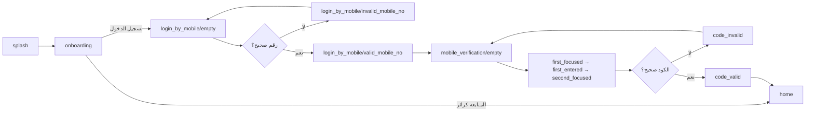

# الدخول والتحقق (Auth)

## الهدف
دخول العميل برقم الجوال وكود تحقق، بدون كلمة مرور، مع إمكانية التصفح كزائر.

## الرحلة

## الشاشات

| الشاشة | الوصف |
|---|---|
| `splash` | الشعار على التدرج الأساسي |
| `onboarding` | «أهلاً بك في بالخدمة» وزرّان: «تسجيل الدخول» و«المتابعة كزائر» |
| `auth/login_by_mobile/*` | إدخال الجوال بمفتاح `+966`، بحالات: فارغ، رقم غير صحيح، رقم صحيح |
| `auth/mobile_verification/*` | كود من 4 خانات، بحالات: فارغ، الخانة الأولى محددة، الأولى ممتلئة، الثانية محددة، كود خاطئ، كود صحيح |
| `auth/login_popup_in_offers_steps` | bottom sheet تظهر للزائر عند محاولة الحجز |

## المكوّنات
`login_by_mobile` و`mobile_verification_by_otp` و`otp_form` و`input_fields` (`type=phone`، `type=otp`) و`text_buttons` و`logo`.

## قواعد العمل
- الزائر يقدر يتصفح الرئيسية والعروض والتفاصيل، لكن الحجز يحتاج تسجيل دخول.
- زر الإغلاق (`navbar_btn_icon`) أعلى شاشات الدخول يرجع المستخدم للخطوة السابقة.

## يحتاج تأكيد
- [ ] مدة صلاحية الكود، وزر «إعادة الإرسال» والعدّاد غير ظاهرين في الشاشات.
- [ ] هل يُطلب إكمال الملف الشخصي (`profile/complete_profile`) مباشرة بعد أول تسجيل؟
