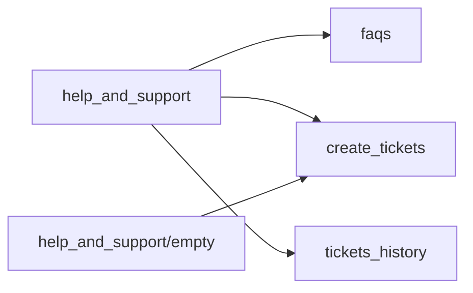

# المساعدة والدعم

## الرحلة

## الشاشات

| الشاشة | الوصف |
|---|---|
| `help_and_support` | الصفحة الرئيسية للدعم (`help_and_support_header`) وقائمة التذاكر (`ticket_item`) |
| `help_and_support/empty` | لا توجد تذاكر |
| `help_and_support/faqs` | الأسئلة الشائعة (`faqs_item`، `state=question|answer`) |
| `help_and_support/create_tickets` | فتح تذكرة جديدة، مع إمكانية إرفاق ملفات (`upload_attachments`) |
| `help_and_support/tickets_history` | سجل التذاكر |

## يحتاج تأكيد
- [ ] حالات التذكرة (مفتوحة، قيد المعالجة، مغلقة) وتفاصيل التذكرة الواحدة: غير مرسومة.
- [ ] ربط التذكرة بطلب معيّن.
