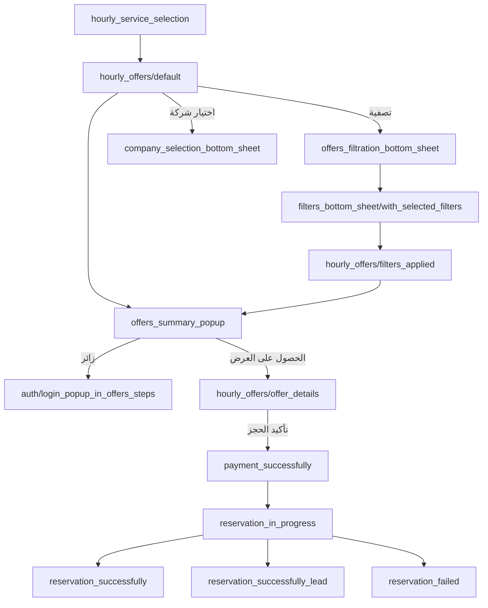

# خدمات بالساعة (Hourly)

الرحلة المرجعية في التطبيق: باقي خطوط الخدمة مبنية على نفس النمط.

## الأنواع الفرعية

من شاشة `hourly_service_selection` («اختر ما يحتاجه يومك، ودع الباقي علينا»):

| النوع | الوصف في التصميم |
|---|---|
| تنظيف مطابخ | عناية بالأسطح والأحواض |
| تنظيف مكاتب | مساحة عمل نظيفة ومرتبة |
| تنظيف عميق | اهتمام بالتفاصيل والزوايا |
| غسيل وكي | عناية بملابسك بالكامل |
| مرافقة شخصية | مساعدة ومرافقة في يومك |
| رعاية طبية | رعاية ومرافقة في يومك |

## الرحلة

## الشاشات

### قائمة العروض: `hourly_offers/default`
- العنوان «عروض تنظيف منزلي» حسب النوع المختار.
- أزرار «تصفية» و«رتّب بـ».
- قائمة `offers_card`.
- بعد الفلترة (`filters_applied`) تظهر الفلاتر المختارة كـ chips (`selected_filter_chips`).

### الفلترة
| Bottom sheet | المحتوى |
|---|---|
| `offers_filtration_bottom_sheet` (نسختان، راجع [S-01](../../brand/deviations.md)) | خيارات الفلترة (`filter_section`)، ونطاق السعر (`price_range_slider`) |
| `filters_bottom_sheet/with_selected_filters` | نفس الشيت بعد اختيار فلاتر |
| `company_selection_bottom_sheet` | اختيار شركة أو أكثر |

### ملخص العرض: `offers_summary_popup`
الشركة وتقييمها، عنوان العرض، السعر شامل الضريبة، والتوفير. وتحتها تفاصيل الطلب: نوع الخدمة، عدد الساعات، الفترة، الجنسية، وما تشمله الخدمة (مثلاً «تشمل منظفات الأرضيات، معقمات الأسطح، سوائل الغسيل ومنتجات النظافة المختلفة»)، ثم زر «الحصول على العرض».
النسخة `without_cleaning_materials` تظهر لما يكون العرض بدون مواد تنظيف.

### تفاصيل الطلب: `hourly_offers/offer_details`
راجع [checkout-and-payment.md](checkout-and-payment.md).

بعد اختيار الأيام وتاريخ البدء بتظهر الحالة [`hourly_offers/offer_details/assigned_workers`](https://www.figma.com/design/mCPCipJETTjSW7GD8vsrzY/Belkhedma-App?node-id=9329-24395). فيها قسم «العاملات على زيارات العقد» ([قرار 0018](../../decisions/0018-visit-first-assigned-workers.md)):
- لكل زيارة كارت [`visit_worker_card`](https://www.figma.com/design/mCPCipJETTjSW7GD8vsrzY/Belkhedma-App?node-id=9425-7013): مربع التاريخ، ورقم الزيارة والوقت، والعاملة اللي الشركة عيّنتها. الضغط على الكارت بيفتح ملف العاملة بزرار «استبدال العاملة» ([قرار 0019](../../decisions/0019-replace-worker-before-payment.md)).
- تنبيه: «يتم تحديد العاملة حسب الإتاحة، ويمكنك استبدالها على أي زيارة بالضغط عليها».

القرار في [0012](../../decisions/0012-hourly-workers.md). العميل مش بيختار العاملة قبل الحجز، ومفيش «عدد العاملات» على العروض.

### جاري تأكيد الحجز: `hourly_offers/reservation_in_progress`
مؤشر من 4 خطوات (`reservation_steps`):
1. التحقق من طلبك
2. حجز طلبك
3. التأكيد مع مقدم الخدمة («قد تستغرق هذه الخطوة بضع دقائق»)
4. تأكيد الحجز

ورسالة «يقوم مقدم الخدمة بإعداد عقدك الآن...» وزر «العودة للرئيسية». العميل يقدر يخرج من الشاشة، والحجز يكمل في الخلفية («ما يحتاج تنتظر هنا، حجزك بيكمل»).

### النتيجة
`reservation_successfully` · `reservation_successfully_lead` · `reservation_failed`، من templates `reservation_success` و`reservation_failed`.

## يحتاج تأكيد
- [ ] خيارات «رتّب بـ» الكاملة (السعر، التقييم…).
- [ ] هل الدفع يتم قبل «جاري تأكيد الحجز» أم بعد موافقة مقدم الخدمة؟ ترتيب الإطارات في Figma يوحي بأن الدفع أولاً.
