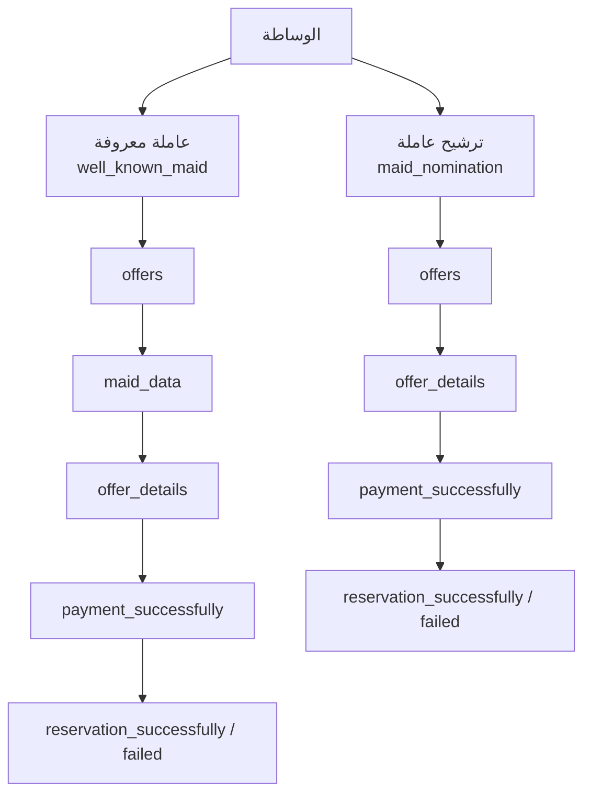

# الوساطة (Mediation)

خدمة استقدام عاملة منزلية عن طريق شركة معتمدة. لها مساران.

## المسار 1: عاملة معروفة (`well_known_maid`)
العميل عنده عاملة محددة، ويريد شركة تتولى إجراءات استقدامها.

| الشاشة | الوصف |
|---|---|
| `mediation/well_known_maid/offers` | عروض الشركات لخدمة الوساطة |
| `mediation/well_known_maid/maid_data` | إدخال بيانات العاملة |
| `mediation/well_known_maid/offer_details` | تفاصيل الطلب، وزر `confirm_payment_button` |
| `mediation/well_known_maid/payment_successfully` | تأكيد الدفع |
| `mediation/well_known_maid/reservation_successfully` · `reservation_failed` | النتيجة |

**حقول بيانات العاملة:**

| الحقل | النوع |
|---|---|
| اسم العاملة | نص |
| رقم الجوال | جوال (`+966`) |
| رقم جواز السفر | نص |
| صورة جواز السفر | رفع ملف (`upload_attachments`) |
| رقم التأشيرة | نص |
| تاريخ الإصدار | تاريخ |
| تاريخ الانتهاء | تاريخ |
| لديها تأشيرة دخول | Checkbox |

## المسار 2: ترشيح عاملة (`maid_nomination`)
الشركة هي اللي ترشّح العاملة للعميل.

| الشاشة | الوصف |
|---|---|
| `mediation/maid_nomination/offers` | عروض الشركات |
| `mediation/maid_nomination/offer_details` | تفاصيل الطلب |
| `mediation/maid_nomination/payment_successfully` | تأكيد الدفع |
| `mediation/maid_nomination/reservation_successfully` · `reservation_failed` | النتيجة |

## بعد الحجز
الطلب يظهر في تبويب «وساطة» في [الطلبات](orders.md). فيه نسخة تفاصيل خاصة للطلب غير المدفوع: `orders/mediation_order_details_unpaid`.

## يحتاج تأكيد
- [ ] نقطة الدخول للوساطة واختيار المسار: لا توجد شاشة اختيار بين المسارين في `screens`.
- [ ] هل الدفع مرة واحدة أم على مراحل؟
- [ ] كيف يختار العميل العاملة المرشّحة في مسار الترشيح؟ (molecule `select_employee_from_branch_note` يوحي بخطوة اختيار من فرع)
