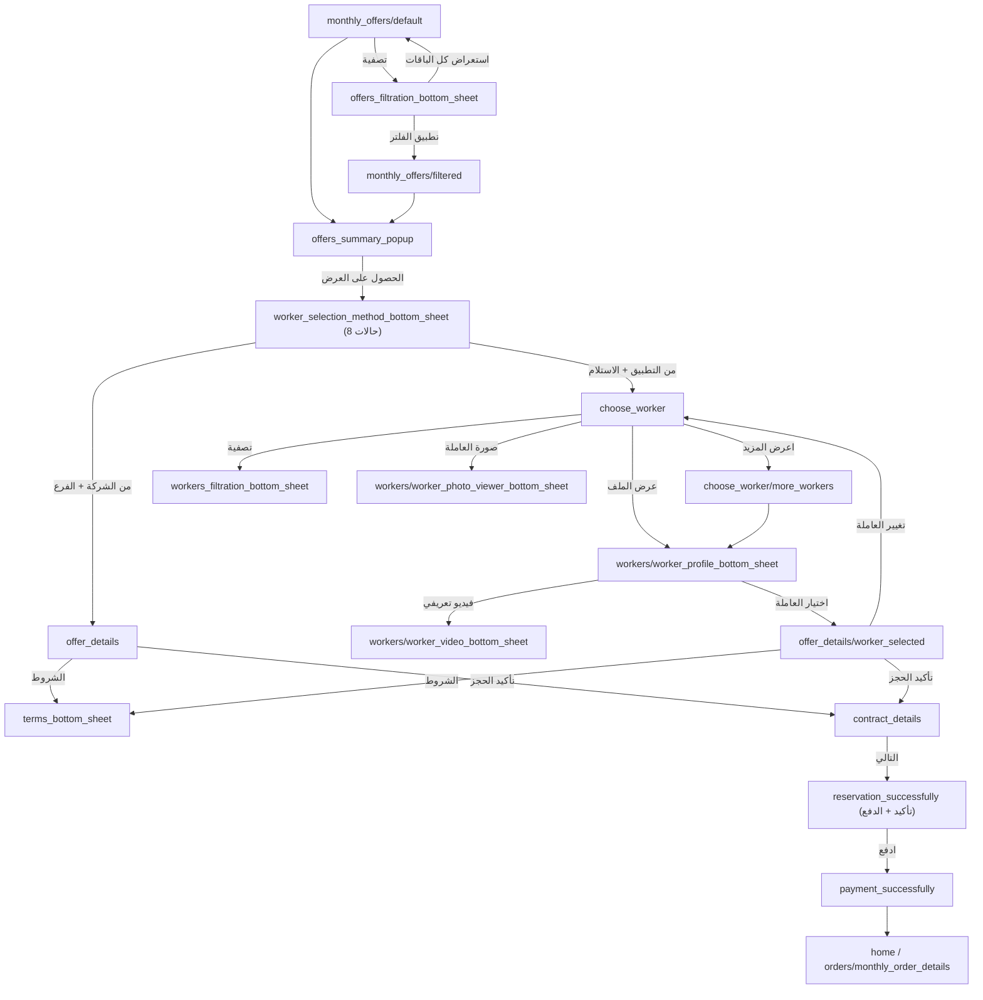

# خدمات الأفراد (شهري) والرعاية الطبية

الخدمتان تتبعان نفس رحلة [خدمات بالساعة](hourly-services.md)، لكن بدون شاشة اختيار نوع فرعي، والعقد مقسّم على عدد زيارات.

## خدمات الأفراد (`monthly`)

الرحلة مطابقة لمسار «باقات الأفراد» في ملف excp ([`individuals_flow/packages/default`](https://www.figma.com/design/4PK0AGuoHmfsLkvN3kVTJC/excp_base_app_atomic?node-id=1200-6241)) من الباقة لحد الدفع ([قرار 0015](../../decisions/0015-monthly-flow-aligned-with-excp.md)). البروتوتايب مربوط ومتراجع: مفيش روابط مكسورة، وكل الشيتات ماشية على [قرار 0009](../../decisions/0009-bottom-sheet-overlay-interaction.md).

| الشاشة | الوصف | المقابل في excp |
|---|---|---|
| [`monthly_offers/default`](https://www.figma.com/design/mCPCipJETTjSW7GD8vsrzY/Belkhedma-App?node-id=892-10966) · [`filtered`](https://www.figma.com/design/mCPCipJETTjSW7GD8vsrzY/Belkhedma-App?node-id=892-10985) | قائمة العروض، وبعد الفلترة | `packages/default` |
| [`offers_filtration_bottom_sheet`](https://www.figma.com/design/mCPCipJETTjSW7GD8vsrzY/Belkhedma-App?node-id=9354-26522) | فلترة العروض | — |
| [`offers_summary_popup`](https://www.figma.com/design/mCPCipJETTjSW7GD8vsrzY/Belkhedma-App?node-id=892-11022) | ملخص العرض و«الحصول على العرض» | `package_details_sheet` |
| [`worker_selection_method_bottom_sheet`](https://www.figma.com/design/mCPCipJETTjSW7GD8vsrzY/Belkhedma-App?node-id=9336-23557) (+ 7 حالات) | «ما هي خياراتك المفضلة؟» ([قرار 0013](../../decisions/0013-worker-selection-sheet-from-excp.md)) | `how_select_worker_sheet` |
| [`choose_worker`](https://www.figma.com/design/mCPCipJETTjSW7GD8vsrzY/Belkhedma-App?node-id=9302-22500) · [`choose_worker/more_workers`](https://www.figma.com/design/mCPCipJETTjSW7GD8vsrzY/Belkhedma-App?node-id=9354-25915) | عاملات الشركة صاحبة العرض، و«اعرض المزيد من العاملات» | `choose_worker/default` · `more_workers` |
| [`workers_filtration_bottom_sheet`](https://www.figma.com/design/mCPCipJETTjSW7GD8vsrzY/Belkhedma-App?node-id=9354-26680) | فلترة العاملات | `filter_sheet` |
| [`workers/worker_photo_viewer_bottom_sheet`](https://www.figma.com/design/mCPCipJETTjSW7GD8vsrzY/Belkhedma-App?node-id=9354-25815) | صورة العاملة كبيرة (بالضغط على الصورة في الكارت) | `worker_photo_viewer` |
| [`workers/worker_profile_bottom_sheet`](https://www.figma.com/design/mCPCipJETTjSW7GD8vsrzY/Belkhedma-App?node-id=9298-23032) · [`worker_video_bottom_sheet`](https://www.figma.com/design/mCPCipJETTjSW7GD8vsrzY/Belkhedma-App?node-id=9354-26601) | الملف الشخصي + «اختيار العاملة»، والفيديو | `worker_employee_sheet` · `worker_video_sheet` |
| [`offer_details`](https://www.figma.com/design/mCPCipJETTjSW7GD8vsrzY/Belkhedma-App?node-id=892-11054) | تفاصيل التعاقد لما الشركة تختار العاملة. راجع [checkout-and-payment.md](checkout-and-payment.md) | `package_details/choose_worker_branch` |
| [`offer_details/worker_selected`](https://www.figma.com/design/mCPCipJETTjSW7GD8vsrzY/Belkhedma-App?node-id=9302-23392) | نفس الشاشة بكارت العاملة المختارة و«تغيير العاملة». ملخص السعر فيه «مصاريف التوصيل : 80» | `package_details/default` |
| [`terms_bottom_sheet`](https://www.figma.com/design/mCPCipJETTjSW7GD8vsrzY/Belkhedma-App?node-id=9354-25712) | «الشروط والأحكام» من الـ checkbox | `terms_sheet` |
| [`contract_details`](https://www.figma.com/design/mCPCipJETTjSW7GD8vsrzY/Belkhedma-App?node-id=9354-25517) | معاينة العقد، «بإكمالك الخطوات فأنت توافق على الشروط والأحكام»، «يتوجب عليك رفع المستندات المطلوبة لاحقاً»، «تحميل العقد»، «التالي» | `contract_details` |
| [`reservation_successfully`](https://www.figma.com/design/mCPCipJETTjSW7GD8vsrzY/Belkhedma-App?node-id=1728-15386) | «تم تأكيد حجزك بنجاح» + اختيار وسيلة الدفع + «ادفع» | `success_contract_sheet` + `payment` |
| [`payment_successfully`](https://www.figma.com/design/mCPCipJETTjSW7GD8vsrzY/Belkhedma-App?node-id=892-11085) | «تهانينا - تم الدفع بنجاح» | `payment_success` |
| [`reservation_failed`](https://www.figma.com/design/mCPCipJETTjSW7GD8vsrzY/Belkhedma-App?node-id=1728-15388) | فشل الحجز. محدش بيوصله في الأفراد، لأن مفيش خطوة «جاري التأكيد» | — |

## الرعاية الطبية (`medical`)

| الشاشة | الوصف |
|---|---|
| `medical_offers/default` | قائمة العروض |
| `medical_offers/filtered` | بعد الفلترة |
| `medical_offers/offers_filtration_bottom_sheet` | خيارات الفلترة |

ملخص العرض وتفاصيل الطلب والنتيجة غير مرسومة كشاشات خاصة بالرعاية الطبية، ويُفترض إعادة استخدام شاشات الشهري **(يحتاج تأكيد)**.

## بعد الحجز
الطلب يظهر في تبويب «أفراد» أو «خدمات طبية» في [الطلبات](orders.md)، مع شريط تقدم الزيارات (مثلاً 12 زيارة) وحالة العقد.

## يحتاج تأكيد
- [ ] مدد العقود المتاحة (شهر، 3 شهور…).
- [ ] هل العميل يختار أيام الزيارة في الشهري كما في الساعة؟
