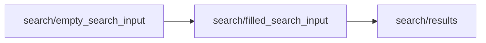

# العروض والبحث والمفضلة

## العروض (تبويب الشريط السفلي)

| الشاشة | الوصف |
|---|---|
| `offers` | صفحة العروض |
| `offers/service_selection` | اختيار نوع الخدمة |
| `offers/service_type_selection_bottom_sheet` | اختيار نوع الخدمة من bottom sheet |

> العلاقة بين هذا التبويب وقوائم العروض داخل كل خط خدمة غير محسومة **(يحتاج تأكيد)**.

## البحث

| الشاشة | الوصف |
|---|---|
| `search/empty_search_input` | حقل البحث فارغ (`search_process`، `state=empty_search_input`) |
| `search/filled_search_input` | أثناء الكتابة (`state=filled_search_input`) |
| `search/results` | النتائج كقائمة `offers_card` |

## المفضلة

| الشاشة | الوصف |
|---|---|
| `favorites` | العروض المحفوظة |

الإضافة من زر القلب (`fav_button`، `state=active|not_active`) الموجود على كل كرت عرض وفي ملخص العرض.

## يحتاج تأكيد
- [ ] حالة فارغة للمفضلة والبحث بدون نتائج (المكوّن `empty_state` موجود).
- [ ] نقطة الدخول للبحث: غير ظاهرة في `top_navbar` الحالي.
