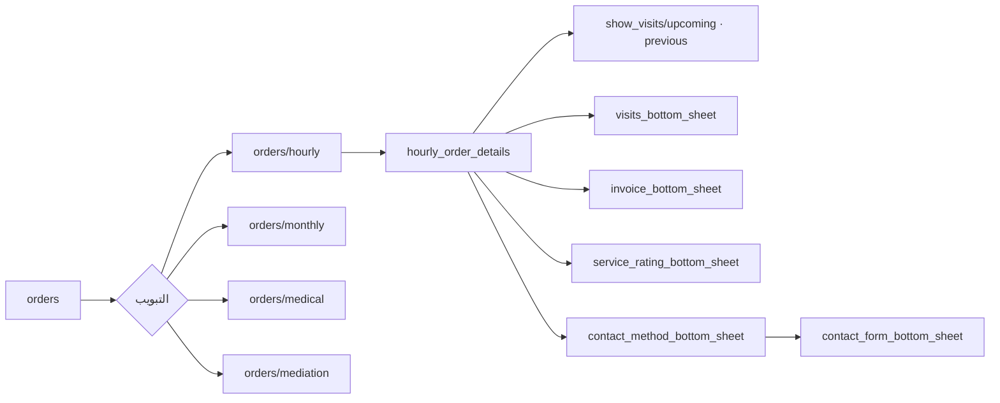

# الطلبات (Orders)

## الرحلة

## قائمة الطلبات
- بحث برقم الطلب («ابحث عن طلب»).
- تبويبات (`orders_tabs`): ساعات، أفراد، خدمات طبية، وساطة.
- كروت `service_order_card`: لكل نوع من الأربعة × 4 حالات.

**محتوى كرت الطلب:** رقم الطلب (مثلاً `#M20082`)، اسم الشركة وشعارها، شارة الحالة، عنوان العرض، تاريخ البدء، تفاصيل الخدمة، السعر، شريط تقدم الزيارات (للطلبات النشطة)، وزر «ادفع الآن» (للطلبات اللي بانتظار الدفع).

| الحالة | الشارة | لون الشارة |
|---|---|---|
| `waiting_payment` | انتظار الدفع | danger |
| `active` | نشط | success |
| `nearing_expiration` | أوشك على الانتهاء | warning |
| `cancelled` | ملغي | رمادي |

## تفاصيل الطلب

| الشاشة | الوصف |
|---|---|
| `orders/hourly_order_details` | تفاصيل طلب الساعة |
| `orders/hourly_order_details/show_visits/upcoming` | الزيارات القادمة (تأجيل). التفاصيل في [visits.md](visits.md) |
| `orders/hourly_order_details/show_visits/previous` | الزيارات السابقة (تقييم العاملة، تفضيل). التفاصيل في [visits.md](visits.md) |
| `orders/monthly_order_details` | تفاصيل الطلب الشهري |
| `orders/medical_order_details` | تفاصيل طلب الرعاية الطبية |
| `orders/mediation_order_details` | تفاصيل طلب الوساطة |
| `orders/mediation_order_details_unpaid` | وساطة غير مدفوعة |

### Bottom sheets من تفاصيل الطلب

| Bottom sheet | الغرض |
|---|---|
| `visits_bottom_sheet` | تفاصيل الزيارات (`visit_details`) |
| `invoice_bottom_sheet` | الفاتورة |
| `service_rating_bottom_sheet` | تقييم الخدمة بالنجوم (`rating_stars`، `state=four_stars_large`) |
| `contact_method_bottom_sheet` | اختيار وسيلة التواصل مع الشركة |
| `contact_form_bottom_sheet` | نموذج تواصل |

الـ bottom sheets والـ popups بتوع الزيارات (`orders/visits/*`: تأجيل، تقييم العاملة، تفضيل) موجودة في [visits.md](visits.md). أما popups الحظر فمؤجلة.

## Templates
- `orders` (`2197:26789`): `state=hourly|monthly|medical|mediation`
- `order_details` (`2197:32206`): نفس الحالات

## يحتاج تأكيد
- [ ] إمكانية إلغاء الطلب من التطبيق، وشروطها.
- [ ] تجديد العقد عند حالة «أوشك على الانتهاء».
