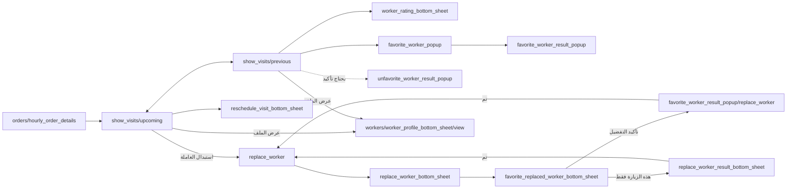

# الزيارات (Visits)

## الهدف
العميل يتابع زيارات طلب الساعة من مكان واحد: يشوف القادمة ويأجّلها، ويقيّم العاملة في الزيارات السابقة ويفضّلها. («حظر العاملة» مؤجل حاليًا، شوف [مؤجل](#مؤجل).) الخصائص دي اتنقلت من Enaya V1 في [طلب التعديل](../../changes/2026-11-16-enaya-visits.md)، والمقارنة الكاملة في [audit المقارنة](../../design-system/audits/2026-11-16-enaya-visits-comparison.md).

## الرحلة

الاستبدال اتضاف في [قرار 0012](../../decisions/0012-hourly-workers.md).

## الشاشات

| الشاشة (اسم الإطار في Figma) | الوصف |
|---|---|
| [`orders/hourly_order_details/show_visits/upcoming`](https://www.figma.com/design/mCPCipJETTjSW7GD8vsrzY/Belkhedma-App?node-id=1587-13309) | ملخص الطلب + تبويب «القادمة». الكارت المفتوح فيه اسم العاملة، وزر «تأجيل الزيارة»، والتنبيه |
| [`orders/hourly_order_details/show_visits/previous`](https://www.figma.com/design/mCPCipJETTjSW7GD8vsrzY/Belkhedma-App?node-id=9081-30591) | تبويب «السابقة». الكارت المفتوح فيه «لا يوجد تقييم للعاملة» + زر «تقييم»، أو التقييم المسجَّل، وزرار «تفضيل العاملة» بعرض الكارت |
| [`orders/visits/reschedule_visit_bottom_sheet`](https://www.figma.com/design/mCPCipJETTjSW7GD8vsrzY/Belkhedma-App?node-id=9081-31157) | «اختيار تاريخ الزيارة»: تقويم شهري، و«تأكيد التأجيل» / «إلغاء» |
| [`orders/visits/worker_rating_bottom_sheet`](https://www.figma.com/design/mCPCipJETTjSW7GD8vsrzY/Belkhedma-App?node-id=9081-31316) | «تقييم العاملة»: اسم العاملة، 4 معايير بالنجوم، «ملاحظاتك على العاملة» (اختياري)، و«إرسال التقييم» |
| [`orders/visits/favorite_worker_popup`](https://www.figma.com/design/mCPCipJETTjSW7GD8vsrzY/Belkhedma-App?node-id=9081-31414) | تأكيد تفضيل العاملة |
| [`orders/visits/favorite_worker_result_popup`](https://www.figma.com/design/mCPCipJETTjSW7GD8vsrzY/Belkhedma-App?node-id=9081-31496) | «تم تفضيل العاملة في 4 زيارات من أصل 50 زيارة، لعدم توفر إتاحيتها في باقي الزيارات» + «تم» / «تواصل عبر واتساب». «تم» بيقفل الـ popup. بتتفتح من الزيارات السابقة |
| [`orders/visits/favorite_worker_result_popup/replace_worker`](https://www.figma.com/design/mCPCipJETTjSW7GD8vsrzY/Belkhedma-App?node-id=9663-25715) | نفس الـ popup، بس في مسار الاستبدال: «تم» بيرجّع لـ `replace_worker` (2026-11-26، طلب منة) |
| [`orders/visits/replace_worker`](https://www.figma.com/design/mCPCipJETTjSW7GD8vsrzY/Belkhedma-App?node-id=9329-23874) | «استبدال العاملة»: «العاملة الحالية في الزيارة» (`worker_card` من غير مهارات)، و«اختيار عاملة جديدة»: بحث (`input_fields` `type=search`)، وتحت البحث صف واحد: على اليمين chips فلترة «المفضلة» و«سبق التعامل معها» وجنب كل واحدة عدد العاملات (`chips` `state=not_active_with_count`، والضغط بيحوّلها لـ `active_with_count` وبيرجّعها)، وعلى الشمال «رتب بـ» (`sorting_dropdown`). مفيش «تصفية» ولا تبويب «الكل»: لو مفيش chip مختارة بتظهر كل العاملات (2026-11-26، طلب منة وأكّدته). في الشاشة «المفضلة» معروضة active. وبعدها قائمة `worker_card` فيها 4 كروت، و«Lakshmi Devi» متكررة فيها بقصد. الضغط على الكارت بيفتح `workers/worker_profile_bottom_sheet/replace_worker` ([قرار 0016](../../decisions/0016-no-buttons-in-worker-cards.md)) |
| [`orders/visits/replace_worker_bottom_sheet`](https://www.figma.com/design/mCPCipJETTjSW7GD8vsrzY/Belkhedma-App?node-id=9354-26768) | «سيتم استبدال العاملة في الزيارة رقم 2 كالتالي:» + العاملة الحالية والجديدة (`contract_information_chip` `full_width`)، و«تأكيد الاستبدال» / «إلغاء» |
| [`orders/visits/favorite_replaced_worker_bottom_sheet`](https://www.figma.com/design/mCPCipJETTjSW7GD8vsrzY/Belkhedma-App?node-id=9354-26847) | «هل تريد تفضيل العاملة …؟ سيتم ترشيحها لباقي زيارات الطلب حسب الإتاحة.»، و«تأكيد التفضيل» (يروح لـ `favorite_worker_result_popup/replace_worker`) / «هذه الزيارة فقط» |
| [`orders/visits/replace_worker_result_bottom_sheet`](https://www.figma.com/design/mCPCipJETTjSW7GD8vsrzY/Belkhedma-App?node-id=9354-26926) | «تم استبدال العاملة»: «ستقوم العاملة … بالزيارة رقم 2.» + «تم»، وبيرجّع لـ `replace_worker` (2026-11-26، طلب منة. قبل كده كان بيقفل الشيت بس، [قرار 0019](../../decisions/0019-replace-worker-before-payment.md)). الرسمة `process_result_vectors` `state=reservation_success` |
| [`orders/visits/unfavorite_worker_result_popup`](https://www.figma.com/design/mCPCipJETTjSW7GD8vsrzY/Belkhedma-App?node-id=9308-24382) | نجاح إلغاء التفضيل: رسمة العاملة بقلب مكسور (`process_result_vectors` `state=unfavorite_worker`)، «تم إلغاء تفضيل العاملة» + «تم». النص ومكان الدخول عليها **(يحتاج تأكيد)** |

حالة «سابقة بعد التقييم» مش شاشة لوحدها. هي متغير `status=previous, state=expanded_rated` في `visit_details`.

## المكوّنات المستخدمة
- [`visit_details`](../../design-system/mobile/organisms.md) (`status=` upcoming · previous × `state=` collapsed · expanded · expanded_rated، و`show_block_worker` = off)
- [`worker_rating_summary`](../../design-system/mobile/organisms.md) و[`worker_rating_criterion`](../../design-system/mobile/molecules.md) (`state=` rateable · rated)
- [`calendar`](../../design-system/mobile/organisms.md)
- `order_summary`، `tabs`، `general_badges`، `outline_notifications` (`status=warning`)، `bottom_sheet_header`، `input_fields` (`type=textarea`)

## كرت الزيارة (`visit_details`)

| الحالة | الشارة | المحتوى وهو مفتوح |
|---|---|---|
| قادمة `upcoming` | «جديدة» | اسم العاملة + «عرض الملف»، و«استبدال العاملة» / «تأجيل الزيارة»، وتنبيه «في حالة تأجيل الزيارة لا يمكن ضمان نفس العاملة حسب الإتاحية» |
| سابقة `previous` | «انتهت» | اسم العاملة + «عرض الملف»، «لا يوجد تقييم للعاملة» + «تقييم»، «تفضيل العاملة» |
| سابقة بعد التقييم `expanded_rated` | «انتهت» | اسم العاملة + «عرض الملف»، «تقييمك للعاملة» بالمتوسط (مثلاً 4.5)، الأربع معايير، ملاحظاتك، «تفضيل العاملة» |

الكارت وهو مقفول فيه: عنوان الزيارة، رقم الزيارة، ووقت الزيارة.

## قواعد العمل
كل القواعد دي جاية من Enaya ولسه متأكدتش من فريق المنتج **(يحتاج تأكيد)**:
- التأجيل للزيارات القادمة بس، والعاملة نفسها مش مضمونة بعد التأجيل.
- التقييم والتفضيل للزيارات السابقة بس.
- التفضيل بيتطبق على الزيارات الجاية في الطلب حسب الإتاحة، وممكن يتطبق جزئياً (X من Y زيارة). ولو اتطبق جزئياً العميل يقدر يتواصل مع خدمة العملاء على واتساب.
- تقييم العاملة منفصل عن تقييم الخدمة (`service_rating_bottom_sheet`) اللي على مستوى الطلب.
- الاستبدال للزيارات القادمة بس، والعاملات من الشركة صاحبة العرض ([قرار 0012](../../decisions/0012-hourly-workers.md)). بعد الاستبدال العميل يختار: يفضّل العاملة الجديدة لباقي الزيارات (نفس بيزنس التفضيل)، أو يخليها للزيارة دي بس.

## الحالات الخاصة
- الحالة الفارغة (مفيش زيارات قادمة أو سابقة): مش مرسومة.
- الخطأ (فشل التأجيل أو التقييم): مش مرسوم.
- التحميل: مش مرسوم.

## مؤجل
**حظر العاملة:** العميل مش عايزه حاليًا، بس ممكن يرجع بعدين. القرار في [0002](../../decisions/0002-defer-block-worker.md).
- **في Figma:** زرار «حظر العاملة» مربوط بـ boolean property اسمها `show_block_worker` في `visit_details`، وقيمتها الافتراضية **off**. لما تبقى off، زرار «تفضيل العاملة» بياخد عرض الكارت كله.
- **الـ popups:** popups تأكيد الحظر ونتيجته اتضاف قبل اسمهم `_`، فبيتجاهلوا ([قرار 0003](../../decisions/0003-underscore-ignored.md)).
- **علشان نرجّعه:** الخطوات والـ node IDs موجودة في [قرار 0002](../../decisions/0002-defer-block-worker.md).

## يحتاج تأكيد
- [ ] فيه حد أقصى لعدد مرات التأجيل، أو نافذة زمنية قبل الزيارة؟
- [ ] التفضيل بيتطبق على الطلب ده بس ولا على كل طلبات العميل؟
- [ ] ينفع العميل يلغي التفضيل بعد كده؟ ومن فين؟ (حالة النجاح اترسمت في `unfavorite_worker_result_popup`، بس زرار الإلغاء وpopup التأكيد لسه مش مرسومين)
- [ ] ينفع العميل يعدّل التقييم بعد ما يبعته؟
- [ ] فيه حد أقصى لعدد مرات الاستبدال، أو نافذة زمنية قبل الزيارة؟ ولو العاملة الجديدة مش متاحة في ميعاد الزيارة؟
- [ ] هل `visits_bottom_sheet` القديمة لسه مطلوبة، ولا الشاشة الجديدة بقت مكانها؟
- [ ] الوصول للزيارات من تفاصيل الطلب بس، ولا هيبقى فيه «زياراتي» عامة زي Enaya؟
