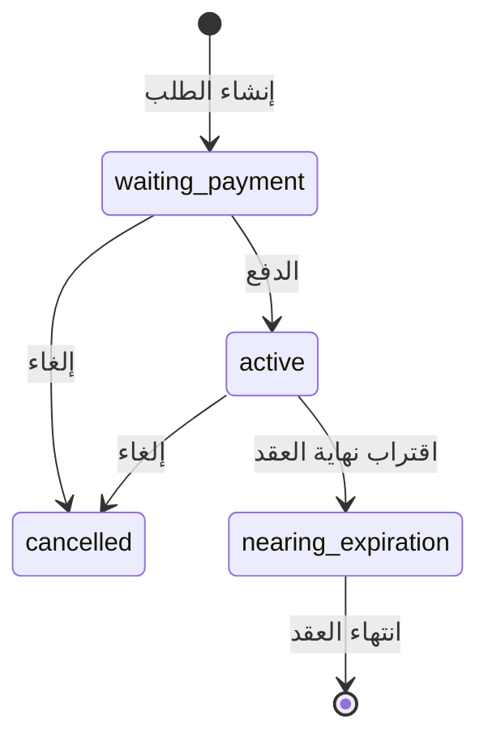

# نظرة على المنتج والبيزنس

## الفكرة

**بالخدمة** سوق إلكتروني (marketplace) يربط العميل بشركات العمالة المنزلية المعتمدة في السعودية. الشركات تنشر عروضها، والعميل يقارن بينها ويحجز ويدفع داخل التطبيق، ثم يتواصل مقدم الخدمة مع العميل ويجهّز العقد.

## الأطراف

| الطرف | دوره |
|---|---|
| **العميل** | يتصفح العروض، يحجز، يدفع، يتابع طلباته، يقيّم الخدمة، ويفتح تذاكر دعم |
| **الزائر** | يتصفح بدون تسجيل دخول، ويُطلب منه تسجيل الدخول عند محاولة الحجز |
| **مقدم الخدمة (الشركة)** | ينشر العروض، يؤكد الحجز، يجهّز العقد، ويرسل العاملة |
| **العاملة** | تنفذ الزيارات. تظهر في العرض بجنسيتها، وفي الوساطة ببياناتها الكاملة |

> التطبيق الموثق هنا هو **تطبيق العميل** فقط. لوحة الشركات ولوحة الإدارة غير موجودة في ملف Figma.

## خطوط الخدمة

| الخدمة | المعرّف | الفكرة | التوثيق |
|---|---|---|---|
| خدمات بالساعة | `hourly` | زيارات بعدد ساعات محدد، ولها أنواع فرعية (مطابخ، مكاتب، تنظيف عميق…) | [hourly-services.md](features/hourly-services.md) |
| خدمات الأفراد | `monthly` | عقد عاملة لمدة شهرية، مقسّم على عدد زيارات | [monthly-and-medical.md](features/monthly-and-medical.md) |
| رعاية طبية | `medical` | تمريض ورعاية صحية منزلية | [monthly-and-medical.md](features/monthly-and-medical.md) |
| الوساطة | `mediation` | استقدام عاملة: عاملة معروفة للعميل، أو ترشيح من الشركة | [mediation.md](features/mediation.md) |

## العرض (Offer)

العرض هو الوحدة الأساسية في المنصة. كل كرت عرض يحتوي على:
- اسم الشركة وشعارها وتقييمها (مثلاً ★ 4.9).
- عنوان العرض، مثل: *«تنظيف منزلي 4 ساعات صباحاً - فلبينية - ضمان بلخدمة الذهبي»*.
- السعر بالريال السعودي، ومقدار التوفير لو فيه خصم (مثلاً «وفّر 50%»).
- شارات مثل «ضمان الاستبدال» و«عرض محدود».
- زر إضافة للمفضلة.

## الإيراد والتسعير

| البند | مثال من التصميم |
|---|---|
| سعر الباقة | 1,970 ر.س |
| ضريبة القيمة المضافة | 15% |
| خدمات إضافية | 15 ر.س |
| **السعر النهائي** | **2,000 ر.س** |

بالإضافة إلى كوبونات الخصم، وأربع وسائل دفع: Visa وMastercard ومدى وApple Pay. التفاصيل في [checkout-and-payment.md](features/checkout-and-payment.md).

## دورة حياة الطلب

| الحالة | الاسم في التطبيق | الإجراء المتاح |
|---|---|---|
| `waiting_payment` | بانتظار الدفع | زر «ادفع الآن» |
| `active` | نشط | متابعة الزيارات |
| `nearing_expiration` | أوشك على الانتهاء | تنبيه للعميل |
| `cancelled` | ملغي | عرض فقط |

> حالة «منتهي» بعد نهاية العقد غير موجودة في التصميم **(يحتاج تأكيد)**.

## نتائج الحجز

| النتيجة | المعنى |
|---|---|
| `reservation_success` | تم الحجز والدفع بنجاح |
| `lead` | «تم إرسال الطلب، شكراً لاختيارك بالخدمة، سنتواصل معك قريباً». الطلب يتسجّل كطلب تواصل، وتتواصل الشركة مع العميل بدل إتمام الحجز فوراً |
| `reservation_failed` | فشل الحجز أو الدفع |

## خريطة الـ features

| الـ Feature | الملف |
|---|---|
| الدخول والتحقق | [auth.md](features/auth.md) |
| الرئيسية | [home.md](features/home.md) |
| خدمات بالساعة | [hourly-services.md](features/hourly-services.md) |
| الشهري والرعاية الطبية | [monthly-and-medical.md](features/monthly-and-medical.md) |
| الوساطة | [mediation.md](features/mediation.md) |
| إتمام الحجز والدفع | [checkout-and-payment.md](features/checkout-and-payment.md) |
| الطلبات | [orders.md](features/orders.md) |
| الزيارات (تأجيل، تقييم العاملة، تفضيل) | [visits.md](features/visits.md) |
| العاملات (الكارت، الملف الشخصي، خطة الإضافة) | [workers.md](features/workers.md) |
| العروض والبحث والمفضلة | [offers-search-favorites.md](features/offers-search-favorites.md) |
| الحساب (الملف الشخصي، العناوين، الشركات، الإشعارات) | [account.md](features/account.md) |
| المساعدة والدعم | [help-and-support.md](features/help-and-support.md) |

## نقاط تحتاج تأكيد من فريق المنتج
- [ ] متى يظهر مسار «إرسال طلب» (lead) بدل الحجز المباشر؟ هل يعتمد على نوع الخدمة أو على الشركة؟
- [ ] نموذج الدفع في الوساطة: رسوم مرة واحدة أم على مراحل؟
- [ ] تبويب «العروض» في الشريط السفلي: هل هو تجميع لكل العروض، أم صفحة خصومات خاصة؟
- [ ] نموذج عمولة المنصة من الشركات.
- [ ] سياسة الإلغاء والاسترداد.
