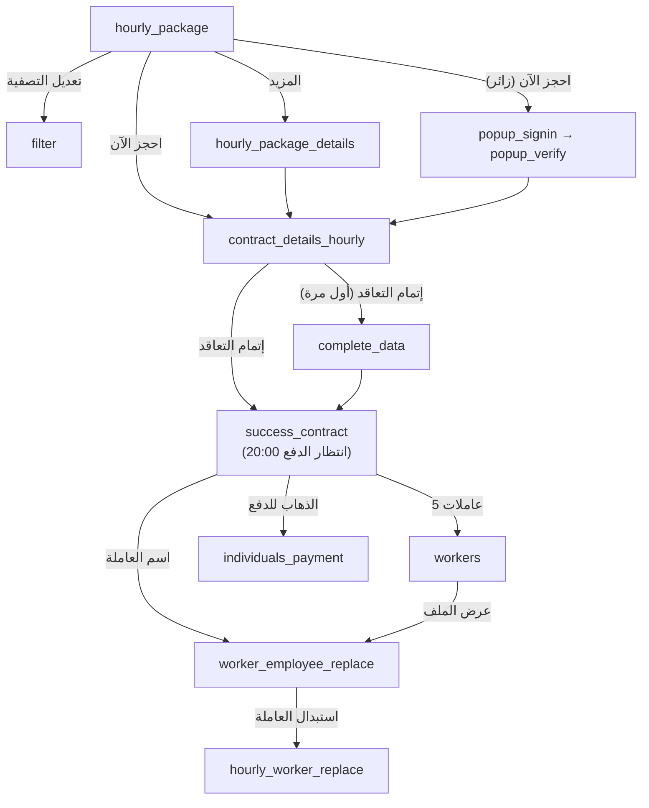
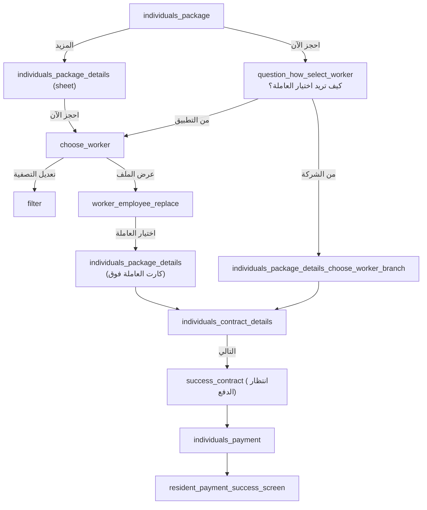
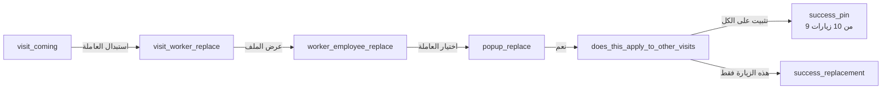

# مرجع: بيزنس العاملات في تطبيق معين (Mueen)

توثيق لطريقة ظهور العاملات وإدارتها في تطبيق معين، كمرجع لإضافة العاملات في بالخدمة. المقارنة مع بالخدمة في [audit المقارنة](../../design-system/audits/2026-11-23-mueen-workers-comparison.md).

> ده توثيق لتطبيق تاني، مش لبالخدمة. كل اللي هنا مقروء من Figma معين (نصوص الشاشات وروابط البروتوتايب) بتاريخ 2026-11-23، ومحدش من فريق معين أكّده.

## الملف
- **Figma:** [`Q0mFJNHw2R1hB37rQDVhAV`](https://www.figma.com/design/Q0mFJNHw2R1hB37rQDVhAV/Mueen_app_atomic_design_system?node-id=0-1) ("Mueen_app_atomic_design_system").
- الصفحة اللي اتقرت: `screens` (`0:1`). صفحة `draft_screens` (`484:191`) فيها نسخ لشاشات دفع بس، ومفيهاش حاجة عن العاملات.

## الخلاصة
| | الساعة (تنظيف المنزل / بلس) | المقيمة (عاملة منزلية مقيمة) |
|---|---|---|
| مين بيختار العاملة | **النظام بيعيّن** عاملة لكل زيارة، والعميل يستبدل | **العميل يختار** من التطبيق، أو يسيبها **للشركة** (فرع) |
| إمتى العاملة تظهر | بعد إنشاء العقد وقبل الدفع | قبل التعاقد (لو اختار من التطبيق) |
| عدد العاملات | 1 لـ 5 لكل زيارة، والسعر بيتضرب في العدد | عاملة واحدة على العقد |
| فلتر العاملات | مفيش (الجنسية فلتر على الباقة) | النوع، الخبرة، الديانة، المهارات |
| الإدارة بعد التعاقد | استبدال، تثبيت، تفضيل، حظر، تأجيل، تقييم | تقييم بس (+ تذكرة، مرفقات، تجديد) |

## كيان العاملة

### كارت العاملة
صورة، الاسم، التقييم (4.5 (85))، الديانة (مسلم)، الخبرة («5+ سنوات خبرة»)، الجنسية، المهارات كـ tags («غسيل و كي» + «+2»)، وزرار «عرض الملف».

### الملف الشخصي (`worker_employee` / `worker_employee_replace`)
| العنصر | المحتوى |
|---|---|
| فيديو تعريفي | زرار بيفتح bottom sheet لوحده (`worker_video`: «فيديو تعريفي للعاملة») |
| البيانات | الاسم، التقييم، الخبرة، الجنسية |
| النبذة | نص حر، مثلاً «متميزة بالدقة والسرعة في الأداء...» |
| المهارات المعتمدة | tags (طباخة، غسيل و كي) |
| الزرار الأساسي | **«اختيار العاملة»** وقت الاختيار، أو **«استبدال العاملة»** + «لست راض عن العاملة؟ يمكنك استبدال هذه العاملة بعاملة أخرى من اختيارك الآن» وقت الإدارة |

## مسار الساعة

### قبل التعاقد
- **مفيش اختيار عاملة.** العميل بيختار باقة.
- **الفلتر** (`filter` `5224:24445`): الجنسية (الهند، إندونيسيا، سيريلانكا، شرق اسيا، بنغلاديش)، الفترة (صباحي / مسائي)، مدة الباقة (1 اسبوع / 1 شهر)، نوع العقد (زيارة مفردة / زيارات متعددة)، عدد الساعات (4 / 6 / 8)، **عدد العاملات (1 لـ 5)**.
- **كارت الباقة** بيقول عدد العاملات، والسعر بيتضرب فيه: «زيارة مفردة، عاملة واحدة» 98.9، «2 عاملة» 197.9، «3 عاملة» 296.9.
- `contract_details_hourly`: تاريخ أول زيارة، توقيت الزيارة، وتنبيه «نرجو الانتباه انه وقت وصول العاملة من 09:00 الى 07:00»، وأيام الزيارات الأسبوعية.

### بعد إنشاء العقد وقبل الدفع (`success_contract` `733:3717`)
- قسم «زيارات العقد»: كارت لكل زيارة فيه **العاملة المعيّنة من النظام** (الاسم + الجنسية + العلم) + «تفاصيل العاملة» + رقم الزيارة والتاريخ والتوقيت.
- لو الزيارة فيها أكتر من عاملة، الكارت بيقول «5 عاملات»، ولما تدوسي عليه يفتح `workers` («العاملات على الزيارة» + «يمكنك استبدال العاملة بعاملة أخرى من اختيارك»).
- رسالة ثابتة: «لا تشيلين هم، بعد الدفع تقدرين تبدلين العاملة، تختارين عاملة محددة، وتديرين جميع زياراتك بكل سهولة.»
- **تناقض:** البروتوتايب بيسمح بالاستبدال من الشاشة دي قبل الدفع، ولما يخلص بيرجع لـ `success_contract`.

## مسار المقيمة

- `individuals_package`: chips الجنسية (الهند، إندونيسيا، سيريلانكا، شرق اسيا، بنغلاديش)، كوبون، باقات 30 / 60 / 90 يوم.
- **`question_how_select_worker`** (`5170:36935`): «كيف تريد اختيار العاملة: من الشركة / من التطبيق».
- **من التطبيق** (`choose_worker` `1200:10151`): «العاملات المتاحة»، الفلاتر المختارة كـ chips (مسلمة، خبرة، أنثى، القيام بمهام المنزل اليومية)، و«اعرض المزيد من العاملات».
- **فلتر العاملات** (`filter` `5178:42336`): النوع (أنثى / ذكر)، الخبرات (بدون خبرة / خبرة)، الديانة (غير مسلم / مسلم)، المهارات الشخصية (كي الملابس، مربية اطفال، القيام بمهام المنزل اليومية، الغسيل، حاصل علي شهادة تدريب).
- **من الشركة** (`1376:12126`): من غير كارت عاملة، ورسالة «سيتم اختار العاملة من فرع الشركة في فرع حي الريان».
- `individuals_contract_details`: «تحميل العقد»، و«يتوجب عليك رفع المستندات المطلوبة لاحقا».
- `resident_payment_success_screen`: الباقة + «عاملة فلبينية · مقيمة» + اسم العاملة.

## إدارة العاملة بعد التعاقد

### زياراتي (`visit_coming` / `visit_past`)
الوصول من القائمة الجانبية («زياراتي») أو من «زيارات العقد» في تفاصيل عقد الساعة.

| التبويب | الإجراءات |
|---|---|
| القادمة | تفاصيل العاملة، **تأجيل الزيارة**، **استبدال العاملة** |
| المنتهية | تفاصيل العاملة، **حظر العاملة**، **تفضيل العاملة**، **تقييم العاملة** |

### الاستبدال

- `visit_worker_replace`: «العاملة الحالية بالزيارة» فوق، وتحتها «تصفح العاملات».
  - بحث بالاسم، و«رتب بـ: الأعلى تقييماً»، وعرض list أو grid.
  - تبويبات: الكل / **سبق التعامل معهم (7)** / **المفضلة (8)**.
- نتائج البحث (`replace_worker_search`) متقسمة: «نتائج من المفضلات»، «نتائج من سبق التعامل معهم»، «نتائج من الكل».
- `popup_replace`: «سيتم استبدال مقدمة الخدمة لهذه الزيارة كالتالي» (العاملة السابقة ← العاملة الجديدة).
- **التثبيت:** «هل تريد تثبيت العاملة لكافة الزيارات القادمة المتاحة في عقدك الحالي؟». النتيجة ممكن تكون جزئية: «تم تثبيت العاملة على عدد 9 من 10 زيارات (لعدم توفر الإتاحية في زيارة واحدة)».

### التفضيل والحظر والتقييم
| الإجراء | الرسالة | الأثر |
|---|---|---|
| تفضيل (`refer_worker`) | «إذا أعجبتك الخدمة، يمكنك إضافة العاملة إلى المفضلة لتسهيل إعادة الحجز مستقبلًا» | بتظهر في تبويب «المفضلة» وقت الاستبدال |
| حظر (`block_worker`) | «إذا لم ترغب في التعامل مع هذه العاملة مرة أخرى، يمكنك حظرها ولن تظهر لك في الحجوزات المستقبلية» | مش بتظهر تاني |
| تقييم (`evaluate_service`) | تقييم العاملة، تقييم العاملة وقت الوصول، تقييم نظام وترتيب العاملة، ملاحظات + تقييم السائق / التوصيل (الالتزام بالموعد، سلوك القيادة والسلامة، معرفة العنوان) | — |

### التعاقدات (`my_contracts`)
- **عقد ساعة** (`my_contracts_hourly_details_*`): «كل الصلاحيات بين يديك الحين! تقدرين تبدلين العاملة، تثبتينها، أو تحظرينها، وتتحكمين بتأجيل الزيارة وتقييم الخدمة بكل مرونة»، ومنه لـ «زيارات العقد».
- **عقد مقيمة** (`my_contracts_individuals_details_*`): «تقييم العاملة» يفتح `workers_active_contract` («العاملات على العقد»، وكل عاملة بفترة تواريخ). باقي الإجراءات: إنشاء تذكرة، رفع المرفقات، تجديد العقد، إيقاف / تفعيل التجديد التلقائي. **مفيش استبدال ولا حظر من التطبيق.**
- **تجديد المقيمة**: `package_renew` ← باقة جديدة ← `question_how_select_worker` تاني. يعني اختيار العاملة بيتعمل من أول وجديد.

## أماكن تانية
| المكان | العاملات |
|---|---|
| طلباتي (`order_*_service`) | نماذج طلب ساعات / مقيمة / وساطة: المهنة والجنسية بس، مفيش عاملة محددة |
| الوساطة (`mediation_form_screen`) | المهنة، الجنسية، تفاصيل. مفيش بيانات عاملة |
| العروض (`offers_details_screen`) | «عدد العاملات: 1»، «الجنسية: كينيا» |
| الرئيسية | «لماذا معين؟ فحص خلفيات / محترفون موثوقون»، وقصة «رفاهية العمال» |
| اسأل معين AI | مفيش حاجة عن العاملات |

## تناقضات في ملف معين
1. نجاح الحظر والتفضيل منسوخ من نجاح التثبيت: «تم حظر العاملة على عدد 9 من 10 زيارات».
2. `resident_payment_success_screen` بيقول «عاملة فلبينية» والعاملة هندية، والفلبين مش في قائمة الجنسيات.
3. قوائم «العاملات» فيها أسماء رجالة (راج كمار، أرجون سيني)، وفلتر المقيمة فيه «ذكر».
4. `cancel_contract` بيودّي لـ `block_success` في البروتوتايب.
5. شاشة اختيار العاملة في المقيمة اسمها `worker_employee_replace`.
6. رسالة الساعة بتقول الاستبدال «بعد الدفع»، والبروتوتايب بيسمح بيه قبل الدفع.
