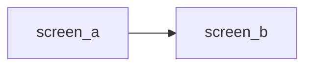

# [اسم الـ Feature]

## الهدف
جملة أو اثنتان: إيه المشكلة اللي بتحلها، ولمين.

## الرحلة

## الشاشات

| الشاشة (اسم الإطار في Figma) | الوصف |
|---|---|
| `section/state` | |

## المكوّنات المستخدمة
`component_a` و`component_b`.

## قواعد العمل
- 

## الحالات الخاصة
- الحالة الفارغة:
- الخطأ:
- التحميل:

## يحتاج تأكيد
- [ ] 
